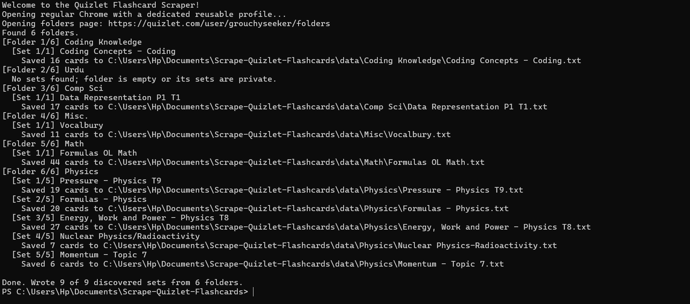
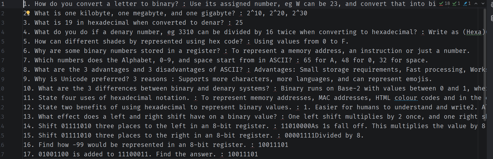

# Scrape Quizlet Flashcards

Back up every public flashcard set in every public folder on a Quizlet user's
folders page. The scraper uses the rendered Quizlet UI with Playwright, validates
the extracted data with Zod, and writes one text file per set.

## Preview




## Install

```powershell
npm install
npx playwright install chromium
```

## Run

Pass the folders-page URL directly, eg:

```powershell
npm run dev -- https://quizlet.com/user/grouchyseeker/folders
```

Or run `npm run dev` and paste the URL at the prompt.

The scraper prefers your installed Google Chrome and attaches Playwright to it
after launch. This avoids the automation-branded test browser that Cloudflare may
reject. Chrome uses a dedicated `.quizlet-chrome` profile, so verification cookies
are retained without reading or changing your personal browser profile. Leave the
window open while verification finishes; the CLI waits for the actual Quizlet
page before it starts looking for folders.

To explicitly require regular Chrome:

```powershell
npm run dev -- https://quizlet.com/user/grouchyseeker/folders --regular-chrome
```

To run Playwright's bundled browser without a visible window:

```powershell
npm run dev -- https://quizlet.com/user/grouchyseeker/folders --headless
```

## Output

Files are written beneath `data/<folder name>/<set name>.txt`:

```text
1. Term : Definition
2. Term : Definition
```

Only public folders and sets visible in the browser can be exported. A failure in
one set is reported and does not stop the remaining sets from being saved.
